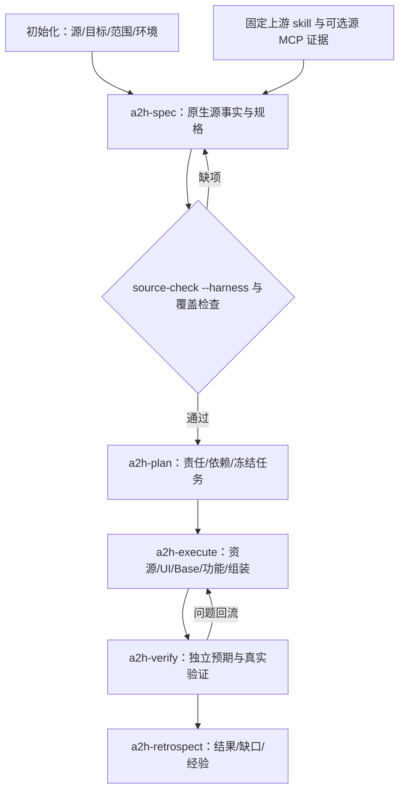

# HMigBot-iOS 0.13.0

0.13.0 补齐 source-analysis 的上下文自动编排：按宿主、工程、既定范围和当前证据实际选择并执行原生采集或冻结回放；自动衔接 SwiftSyntax、Clang、条件编译、资源和规格候选。适用 Apple 官方技能、只读 Xcode MCP 与官方 CLI 优先，保留实际授权失败和备用来源；远程控制设备排除在默认范围。每轮输出逐步进度、原始日志和下游消费证据。见 [自动编排协议](skills/ios-source-analysis/references/auto-orchestration.md) 与 [能力目录](docs/integration/CAPABILITIES.md)。93 项能力数量保持不变，编排器不重复计数。


统一原生流程见 [使用规程](docs/WORKFLOW.md)，能力对应的实现和回归入口见 [机器目录](src/hmigbot_ios/semantic_capabilities.json)。开发过程报告、合并验收证据和历史评估留在本地，通过 `.gitignore` 排除；代码、技能、schema、运行依赖及固定测试夹具继续纳入版本管理。

0.11.0 修正规程与准入冲突，接通已有prompt_scope作者入口，减少同次调度重复hash，增加显式在途token预留及完整provider计划预检。源分析回执记录当前host发现，仍不自动执行Xcode或证明符号绑定。见 Windows改造合同（本地过程记录：`docs/WINDOWS-FOUNDATION-20261022.md`）、[预留操作](docs/USAGE-RESERVATIONS.md) 与自足的 Mac交接（本地过程记录：`docs/MAC-HANDOFF-20261022.md`）。旧源基线仍需按原流程重提/复审；首个预留将usage账本升级为schema 2，旧运行时应拒读而非忽略在途额度。工具测试不代表真实App双100%、2小时或20M目标达标。

0.10.1 区分模型 `.id` 值读取与 SwiftUI 身份调用，保留真实 UI 身份判据及保守未知分支。升级须按原 `facts` 流程重提并复审旧基线，不能继承旧门禁结果。

0.10.0 增加新工程的 `source-analysis` / `spec-scaffold` 候选入口、按任务分配的决策上下文、调用用量与完整计时账本；强化中文功能文档、零对象、覆盖归属、提取问题身份和 Swift 字符串边界检查。同步目录仅形成项目声明范围，未知语义与未测项继续阻断验收。见 [可靠性工作流与验收边界](docs/RELIABILITY-0.10.md)。

0.9.2 修复 Xcode 自动自引用 workspace/用户状态引起的源快照误报，增加与正式门禁共享字段、完整性及锚点合同的只读规格生成辅助。共享 Scheme、锁文件、真实工程引用和源码继续参与摘要；未知语义继续阻断。见[修复范围与升级步骤](docs/SOURCE-AUTHORING-0.9.2.md)。

0.9.1 修复 WorkBuddy 评估中独立复现的解析、冻结和 raw 字符串问题，同步 Spec/Plan/Execute/Verify 的 MD 规则与检查器；增加受控旧规格诊断及真正由当前逐页证据生成、可检查是否过期的报告。见 整改对应表（本地过程记录：`docs/WORKBUDDY-0.9.1.md`） 与 [旧规格升级步骤](docs/SPEC-UPGRADE.md)。

已合入main的iOS对齐工作：① 六个流水线技能（a2h-init/spec/plan/execute/verify/retrospect）参照原版 HMigBot 1.7.0 的写作方法论整体重写——统一「精确命令表 / 黑体硬约束 / 无人值守处置阶梯 / 读取时机表 / 交接闸 / mark-stage 收尾」骨架，全部命令核对真实 `a2h_ios.py` flags；a2h-verify 补回原版 CHECK-5 行为验证语义（`behavior-check` 只报告、不参与整体判定）。② 七个 ios-* 技能深化到安卓原版对应技能的等价深度（接口接缝框架、pbxproj 分层、状态装饰器分类、行为链六维度、xcassets 全表等），iOS 语义红线逐条保留。③ `doctor` 输出新增 `host_profile` 宿主能力协商：macOS+Xcode → 原生能力候选，Windows/Linux → static候选；可用性不代表已执行原生解析，Apple skill/Xcode MCP 按 available/configured/executed 三态记录。④ 明确维护原则：原版共享技能（arkts-*/hmos-* 等）冻结不改，只改 iOS 版新增/修改的技能。审计与写作基线见 对齐审计（本地过程记录：`docs/IOS-ALIGNMENT-1.7-AUDIT.md`） 与 [技能写法方法论](docs/SKILL-AUTHORING-METHODOLOGY.md)。

读取原生 iOS 源码与功能特征，按原 HMigBot 五阶段生成 spec、计划和原生鸿蒙代码。
本工具保留独立 HMigBot CodeX 1.6.1 的实施/验证资源，并接入 1.7.0 调度核心；所需资源随包提供，无需原插件目录。

**主入口：`$a2h-run`。主线：a2h-spec → a2h-plan → a2h-execute → a2h-verify → a2h-retrospect。**
由宿主模型执行技能规程完成理解、设计、编码和修复；脚本负责索引、检查、构建与证据记录。
`bin/a2h` 是原运行支持程序，不能单独完成语义迁移。

## 规格内容与消费合同

0.9.0 将 Spec/Plan 的提纲、核心表头、JSON 字段、来源映射和任务消费规则一起发布。新项目启用内容 profile 2：MD 负责源行为、目标合同、分析步骤和独立复核；随包 catalog/schema 与实际检查器核对同一套产物。Plan 的 MD 项、JSON 投影和调度任务必须对应，任务携带传递合同输入；文件唯一写权沿用原调度器。详见 [0.9.0 合同与施工说明](docs/SPEC-PLAN-CONTRACT-0.9.md)。

新增只读 `plan-check`、`product-literals`、`spec-summary`。产品字面量视图保留原始来源，区分产品、Preview、测试及未知；汇总将生成、编译、行为、视觉证据分开。历史 `verified` 只展示为兼容进度，缺失或过期证据不升级为通过。已有项目默认继续 profile 1，须显式补规格、独立复核和重排后升级，原 F/page/AC ID 保持稳定。

a2h-spec 交付源行为、目标公共接口、状态/接线、批准差异与独立 AC，plan 分配施工，execute 按合同实现并定向回读源码。新增只读 `spec-check --project <target>`；`source-check --harness` 内置同一内容门禁，薄规格、未定义目标、源属性代替目标状态、import/Preview 真值及延迟断言会被阻断。

共享接口在主规格通过 `contract_refs` 引用精确文档/标题，domains 冻结传递引用及决策账本。真实 Preview 义务保留，经当前文件哈希、精确区间、源审阅与 skip-list 验证后才可排除产品实现；未知条件编译仍不放行。详见 [规格合同与升级](skills/a2h-spec/references/spec-delivery-contract.md) 和 [实现/验证边界](docs/SPEC-CONTRACT-0.8.md)。程序门禁不证明模型的全部语义正确或 App 已验收。

## 0.6.0 可执行 Harness

七个 iOS 技能接入机器事实、覆盖义务、稳定 AC、冻结计划和摘要回执。实现执行采用原版 `next_batch → dispatch → receipt → land_results`，旧版通过记录需显式导入复核。错误初值、笼统不适用、遗漏义务、越界写入和空处理器有程序门禁；生成、编译、行为观察分开记录。

[实现范围与限制](docs/HARNESS-0.6.md) · [字段、命令和恢复协议](skills/ios-source-analysis/references/harness-v2.md)

本轮验证为工具/合同/安装及隔离夹具，未完成指定真实 App 的双端设备验收。缺少运行证据的 AC 保持 UNVERIFIED。

## 0.7.0 外部 iOS 专业能力

固定版本的上游资料实际随包提供，安装后无需联网获取；由原 iOS 分析技能按主题加载，
专业知识与源事实分别记录。未修改上游文件，不把上游开发/现代化指令用于修改待迁移源仓。

| 上游资料 | 固定提交 | 使用位置 | 本版状态 |
|---|---|---|---|
| [AvdLee SwiftUI](https://github.com/AvdLee/SwiftUI-Agent-Skill) | `204dba7c67256a8b707ee3fbc5759a824191974f` | UI 状态、组合、身份、导航、布局 | MIT；已导入实际 skill、参考和脚本 |
| [AvdLee Swift Concurrency](https://github.com/AvdLee/Swift-Concurrency-Agent-Skill) | `d5770817d2622e1585b1f7eaebc791a9cb0959c8` | 工程并发配置、任务/Actor、取消、回调、生命周期 | MIT；已导入实际 skill 和参考 |
| [Axiom UIKit/内存主题](https://github.com/CharlesWiltgen/Axiom) | `d35eaca69e423d5157bb39c2a1b5f76ff9802f86` | UIKit、桥接、Auto Layout、Scene、Combine、ARC/block | MIT；只导入所选主题 |

共 3 个快照、87 个文件，来源和逐文件 SHA256 在 `vendor/ios-expertise/manifest.json`。
运行 `expertise-audit` 核验；`expertise-plan` 产生本轮加载清单，`expertise-review` 保存实际源观察。
必需审阅缺失、资料摘要不符、源码变化或清单被编辑时，`source-check --harness` 拒绝进入实现计划。
上述检查保证来源/记录合同，不证明模型的语义判断正确；独立源审阅和行为验收继续必需。

| MCP/工具能力 | 本版接入方式 | 实际运行前提/状态 |
|---|---|---|
| Serena / SourceKit 类 MCP | 已实现 stdio 初始化、工具发现、源只读查询、原始结果采集和证据关联门禁 | 服务另行安装并固定版本；本轮仅实测隔离协议服务，未实测真实 Serena/SourceKit |
| Apple Xcode MCP | 同一适配器支持 XcodeRead/Grep/Glob 等源读工具；按实际 tools/list 判断可用性 | Mac/Xcode 打开源工程并启用访问；本机未连接 |
| MobileBuildMCP | 源端构建/测试/日志通过宿主可用工具或其真实 CLI，进入原采集/验证协议 | 可选；需 Mac/Xcode；本机未连接；不属于源只读适配器白名单 |
| DevEco/hvigor/hdc 与原校验器 | 保留原 HMigBot 构建、结构、UT、UI/视觉流程 | 按实际目标 SDK、签名和设备判定；工具发行测试不代表用户 App 已验收 |

MCP 未配置时可继续源码静态分析；依赖有效构建、动态绑定或运行观察的结论保持 unknown/待验。
本版 MCP 响应为 `tool_response`，不自动改写机器 facts，也不提升为 compiler_binding/runtime。
本版实现 stdio；远端 Mac 可提供显式 SSH stdio 桥，HTTP transport 尚未实现。
Serena 最新应用为 GPL-3.0-or-later，SolidLSP 为 MIT；本包未打包 Serena 应用。
[运行与字段协议](skills/ios-source-analysis/references/external-expertise.md) ·
[第三方许可](docs/THIRD-PARTY-NOTICES.md)

## 安装

需要 Python 3.11+。解压发行包，进入 `hmigbot-ios` 目录，在 Windows 执行：

```powershell
powershell -NoProfile -ExecutionPolicy Bypass -File .\install.ps1 -Workspace 'D:\Ios2Harmony'
```

指定解释器可增加 `-Python 'D:\DevTools\Python\python.exe'`。安装到实际迁移工作区即可。
macOS 安装入口为 `PYTHON=python3 sh install.sh /absolute/workspace`；本轮只在 Windows x64 实测。
原校验器提供 Windows x64 / macOS arm64 资产；Linux 缺多个原编译校验器，不能视为完整可运行平台。
建议为 ZIP、解压与安装预留 4 GB。鸿蒙编译需要另装 DevEco Studio/SDK。

再次运行安装脚本即升级；用户修改的托管文件会报冲突并保留，不能强删绕过。
卸载使用 `uninstall.ps1 -Workspace 'D:\Ios2Harmony'`，只删除未修改的托管文件。
应用源码、spec、目标产物和用户规则保留。[完整安装说明](docs/INSTALL.md)

## 使用

安装后重新打开工作区会话，使宿主重新发现技能。源、目标目录须互不包含。

```text
$a2h-run 将 D:/Projects/MyNativeApp 的原生 iOS 源工程迁移到当前鸿蒙工作区。
按源行为生成保留 iOS 特征的 spec，沿原 a2h 流水线持续实现、编译和验证。
缺少运行环境的检查保留待验状态，不把生成或静态检查当成行为一致。
```

也可仅运行 `$a2h-spec`、`$a2h-plan` 或已授权范围。尚未选定源 App 时只安装工具，
不会把内置夹具当用户应用。初始化由 `$a2h-init` 维护真实配置：

```powershell
python .hmigbot-ios/plugin/scripts/a2h_ios.py init --source 'D:/Projects/MyNativeApp' --project '.'
```

配置使用 `source_platform: ios`、`ios`、`harmonyos`；构建工具路径按实际环境填写。
没有 Mac 仍可读源码和实施鸿蒙代码；源编译、iPhone 安装、源运行与双端验收单独记录。

报告落盘推荐用 `--brief` 只保留小回执，完整内容在输出文件（不带 `--brief` 时 stdout 行为不变，`--check` 语义不变）：

```powershell
python .hmigbot-ios/plugin/scripts/a2h_ios.py spec-summary --project '.' --output './spec/reports/spec-summary.json' --brief
python .hmigbot-ios/plugin/scripts/a2h_ios.py migration-report --project '.' --output './spec/migration-report.md' --brief
```

### 只读环境诊断 doctor

`doctor` 是纯静态、只读的环境诊断，回答“当前能做什么、缺什么、下一步动作”，不构建、不安装、不执行 Swift 或任何外部工具。两个公开入口都提供同一 `doctor` 子命令：

```powershell
# a2h 原生入口
python .hmigbot-ios/plugin/scripts/a2h_ios.py doctor --project '.' [--config '.migbot/config.json'] [--text]
# iOS 适配器入口
python .hmigbot-ios/plugin/scripts/ios2harmony.py doctor --project '.' [--config '.migbot/config.json'] [--text]
```

`--project` 是被检查的真实工程根，即原生流水线实际使用的 HarmonyOS 目标；`--config` 显式指定配置时以其为准，缺失或非法直接失败而不回落到默认配置。诊断边界：iOS 源不得等于、包含或被包含于 `--project`，配置的 `harmonyos` 目标须与真实 `--project` 规范化相等，否则不得掩盖源嵌入目标的事实。

静态诊断限制（如实）：退出码 0 只表示“诊断完成”，不代表环境就绪；就绪与否看报告 `overall` 字段——边界或配置错误时 `overall=config_error`，即使进程正常结束。存在性 ≠ 版本兼容 / 可执行 / 已验证；源根出现 `Package.swift` 只报 `pending_evidence`，正式计划门禁仍需真实的 SwiftPM 求值证据，doctor 只 stat 源根自身清单、不递归、不代执行、不复用旧 PASS。

## 迁移流水线、细分步骤与阶段交接

以下路径均相对**鸿蒙目标项目根目录**。`<runtime>` 在安装后为 `.hmigbot-ios/plugin`。
F/AC 是稳定功能/验收 ID；源事实 ID 关联原生语义和验收，不能用生成的目标实现反推源预期。
主入口 `$a2h-run` 依次消费五阶段产物；脚本负责机械检查，宿主模型按 skill 读取、解释、实现。



### 准备：初始化与范围确认

| 细分步骤 | Skill / MCP / 工具 | 产物及后续用途 |
|---|---|---|
| 定位分离的 iOS 源根与鸿蒙目标、确认迁移范围和已有授权 | a2h-init、a2h-run | `.migbot/config.json` 的 source_platform/ios/harmonyos；所有阶段从这里取路径 |
| 核验 DevEco/SDK/Node/JDK/ohpm/hvigor/hdc 等实际环境 | hmos-env-doctor；源端 Xcode/设备能力可选 | 环境检查结果、可执行/不可执行项；环境缺口不能写成运行通过 |
| 新项目初始化；旧 baseline 保留 ID 与历史后导入/复核 | harness-init/import-legacy；原 findings 工具 | harness 标记、旧记录 history、`spec/.a2h/open-findings.json`；新初始化启用外部专业审阅门禁 |

### 第一阶段：a2h-spec——源理解与规格

**输入：**真实 iOS 源码、配置、范围、既有 decisions/findings。**本阶段不写鸿蒙生产代码。**

| 细分步骤 | Skill / MCP / 工具 | 主要产物 |
|---|---|---|
| 1.1 自动选择证据、建快照、提取信号/义务和字面量 | ios-source-analysis；source-analysis 自动衔接适用原生/冻结证据、官方资料和 provider；保留低层入口 | `spec/baseline/ios-source-index.json`、`ios-facts.json`、`ios-obligations.json`、`literal-ledger.json`；provider 原始产物在 `spec/ref/provider-runs/` |
| 1.2 确定本轮专业资料；读取实际文件并分配分析 owner | expertise-plan；AvdLee/Axiom 固定资料 | `spec/ref/ios-expertise-plan.json`，给出上游文件摘要、源范围、事实 ID 和 UI/功能主题 |
| 1.3 识别工程/target/scheme/configuration、依赖与语言边界 | ios-project-inspector；Concurrency 工程配置规程；可选 Xcode/SourceKit MCP | `spec/ref/ios-project.md`、`module-index.md`、`ios-project-signals.json`；有效构建成员未确认则保留 unresolved |
| 1.4 沿入口分析 SwiftUI/UIKit/IB、状态、事件、导航和布局 | ios-ui-analyzer；AvdLee SwiftUI、Axiom UIKit/内存资料；可选源 MCP | `spec/ref/ios-ui-facts.md`、`ios-ui-signals.json`；页面/状态矩阵、source anchors、原生语义候选 |
| 1.5 沿行为链分析规则、错误/取消、任务/Actor、数据流和恢复 | ios-feature-analyzer；Swift Concurrency、适用 Axiom 资料；可选定义/引用查询 | `spec/ref/ios-feature-facts.md`、`ios-feature-signals.json`；输入→处理→状态/副作用→观察、源端独立预期 |
| 1.6 核对网络、系统 API、权限、entitlements、三方接缝 | ios-api-inventory；适用系统/三方目标技能；可选源 MCP | `spec/baseline/api-inventory/`、`ios-api-signals.json`；原服务契约和平台差异候选 |
| 1.7 保存专业审阅与实际工具使用证据 | expertise-review、mcp-query；源分析 owner | `spec/ref/ios-expertise-reviews.json`；可选 `ios-mcp-index.json`、`mcp-runs/MCP-ID/`；`ios-analysis-provenance.json` 由分析 owner 记录实际来源与使用状态 |
| 1.8 合并 UI/功能规格、稳定 ID、AC 与批准的差异 | a2h-spec；a2h-functional-registry/merge、arkts-ui-alignment；decision-ledger | `spec/baseline/ui-manifest.md`、`ui/page_*.md`、`feature-index.md`、`feature-base.md`、`features/F*.md`、`ios-semantics.json`、`ios-coverage.json`；复杂细节放 addendum，截图仅在实际采集后登记 |
| 1.9 检查范围、义务→AC、原生语义、源证据和依赖项 | source-check --harness；arkts-ui-coverage-auditor、arkts-feature-coverage-auditor；原 addenda/divergence/literals/traceability 校验 | `spec/baseline/ios-source-check.json`、`spec/reports/ios-harness-check.json`、`spec/ui-coverage-report.md`、`spec/baseline/source-coverage-report.md`、`spec/.a2h/requirements-index.json`、共享 findings |

**交给 plan：**baseline、源语义、稳定 AC、decisions、已审阅外部资料与工具证据、覆盖报告。
源门禁及计划要求的覆盖检查通过后排期；unknown 阻断受影响实现，未解释调用/源版本变化回本阶段。
专业审阅记录不能替代源语义、义务覆盖或独立 oracle。

### 第二阶段：a2h-plan——责任、依赖与执行计划

| 细分步骤 | Skill / MCP / 工具 | 产物及衔接 |
|---|---|---|
| 2.1 回读 baseline、覆盖和 findings，确认未决替代已处理 | a2h-plan；source-check --harness；原覆盖消费者 | 待排范围与已批准 decisions；失败回 spec，保留稳定 ID |
| 2.2 规划 UI、公共 Base 和功能切片 | a2h-plan；按需项目/状态/数据/导航/系统/三方目标技能 | `spec/baseline/plans/ui-plan.md`、`base-plan.md`、`feature-plan.md` 索引、同目录 `slices/*.md` |
| 2.3 指定具体文件 owner、依赖、共享接线与占位解决者 | a2h-plan 原 indexed 规程 | `spec/baseline/plans/coverage-matrix.md`、`spec/placeholder-registry.md`；共享文件单一 owner，依赖形成 DAG |
| 2.4 对账全部 AC 的任务归属与源语义约束 | 原 lint_plan_coverage、UI/Base/Slice 校验 | `spec/.a2h/plan-coverage.json` 和检查结果；不得遗漏检测义务或降低验收强度 |
| 2.5 将可读计划转为冻结机器计划 | plan-ir；原调度器初始化 | `spec/blueprint/`、`spec/waves/plan-domains.json`、`prompts/domains/*.txt`；冻结 baseline、专业审阅和 MCP 证据摘要 |

**交给 execute：**冻结任务书、ownership/DAG、fact/AC 引用、目标契约和 decisions。
已有授权直接沿用；只有新的产品取舍需要具体决定。本阶段通常不查询 MCP，发现新源事实缺口回 spec。

### 第三阶段：a2h-execute——鸿蒙实现与编译收口

| 细分步骤 | Skill / MCP / 工具 | 主要产物 |
|---|---|---|
| 3.0 派发、等待、回执、落账，持续核对冻结输入 | a2h-execute；next-batch/receipt/land-results；支持角色按任务使用，不能派发时按同任务书串行 | 原三份状态账本、`spec/waves/results/`、任务真实文件摘要；done 只表示生成任务落账 |
| 3.1 Stage 0：目标骨架、应用身份与资源 | arkts-project-scaffolder、arkts-app-identity、ios-resources-convert、arkts-i18n | Harmony 配置、resources、资源映射与缺口；不猜图片逻辑尺寸或字体/颜色变体 |
| 3.2 Stage 1：分页 ArkUI 转换、状态接口、导航接线 | ios-ui-to-arkui；arkts-component-builder/state-manager/navigation-builder/ui-alignment/animation 等按页面计划使用 | `.ets` 页面/组件、接口、UI batch brief；状态与 task 语义来自 spec，不能机械套目标装饰器 |
| 3.3 Stage 2：公共基础设施 | 原 Base worker/closer；arkts-data-layer、state-manager、system-capabilities、library-migration 等按计划使用 | 模型/服务/存储/共享组件、`spec/execution/base-contracts.md`、Base brief |
| 3.4 Stage 3：功能切片、ViewModel/Repository 与副作用 | 原功能 worker/closer；目标系统/登录/支付/媒体/WebView 等领域技能 | UI←VM←Repository←API/DB 真实闭环；复杂切片 `spec/execution/source-understanding/*-source-notes.md`、slice brief |
| 3.5 组装、结构/接线/占位收敛、真实终态构建 | arkts-structural-closure/router-verify、hmos-fix-build-errors/hmos-builder、a2h-build；实际 hvigor | 结构/接线检查、构建日志/退出码/HAP、`spec/migration-report.md`；编译失败回实现，行为仍待验证 |

**交给 verify：**当前源码与摘要、真实编译证据、实现/接线 brief、AC 实现指针和未关闭 findings。
通常使用冻结源证据；新增源查询要回 spec 复核并显式 replan，不能在执行中改 baseline/任务书。
MobileBuildMCP 可辅助源端构建核验，但不能替代鸿蒙 hvigor 或目标行为测试。

### 第四阶段：a2h-verify——独立预期与真实验证

| 细分步骤 | Skill / MCP / 工具 | 主要产物与判定 |
|---|---|---|
| 4.1 确定已授权验证范围，核对本轮源/目标版本和设备 | a2h-verify；按原协议采用已选择项 | 执行范围与未选择/环境不足项；不重复询问已明确授权的验证 |
| 4.2 固定 CHECK-1 静态分析、CHECK-2 身份检查 | a2h-verify、arkts-app-identity；原检查资源 | 静态/身份结果、WARN/FAIL；结构通过不表示功能一致 |
| 4.3 构建事件/存储行为链、核对独立源 oracle | behavior-check；ios-feature-analyzer/source anchors | `spec/baseline/ios-behavior.json` 及链路检查；未运行或未覆盖为 UNVERIFIED |
| 4.4 按已选范围运行逻辑、UI、视觉与设备场景 | arkts-ut-verifier、arkts-ui-verifier、arkts-visual-verify、arkts-scenario-runner；实际设备工具；可选 MobileBuildMCP 源观察 | UT/UI/视觉/设备测试记录、截图/日志、真实动作与结果；`behavior-check --run` 保存实际进程输出和独立 expected 比较 |
| 4.5 修复、复测、对账覆盖与当前摘要 | 原 verifier/fixer 闭环；跨层问题回 a2h-execute，源预期问题回 a2h-spec | 原 `spec/fix/` 与 verifier 轮次、共享 findings；修改后旧结果不覆盖当前代码 |
| 4.6 汇总约定范围的真实状态 | a2h-verify、原 AC 追踪消费者 | `spec/verify-report.md`、verification/impl claims；分别列生成、编译、行为观察、设备验证及未覆盖项 |

**交给 retrospect：**本轮验证报告、执行报告、计划/brief、源工具实际证据和未决清单。
报告已形成即可复盘失败/待验原因；不能因为进入第五阶段而把失败或缺设备标成完成。

### 第五阶段：a2h-retrospect——复盘与经验反馈

| 细分步骤 | Skill / MCP / 工具 | 主要产物与反馈 |
|---|---|---|
| 5.1 对照 UI/Base/Slice 计划、实际 skill 使用、brief 与验证 | a2h-retrospect | `docs/retrospect-report-YYYY-MM-DD.md` 的计划/实际差异、漏迁/错误来源；稳定 ID 保留 |
| 5.2 分析外部资料/MCP 是否改善理解，区分源事实与最佳实践误用 | a2h-retrospect；expertise/mcp 原始记录 | 同一复盘报告的 skill 来源/版本/主题、工具实际执行、未知项与误判；不从 Stars 推断准确率 |
| 5.3 提炼已验证的映射、规则修正与候选补丁 | 原 retrospect references、目标领域技能 | `spec/memory/*.md`、`spec/retrospect-counter.json`、满足原条件的自有 reference 更新或 staged `.patch` |
| 5.4 保留 findings 与下一轮输入，审阅后升级固定资料 | a2h-retrospect；source-refresh/replan；bundle audit | 复盘报告中的恢复步骤、`spec/.a2h/open-findings.json` 与 history；升级重核许可/摘要与回归，不改原快照或继承旧 PASS |

**回到下一轮：**新增需求/源变化先更新源事实和规格；实现问题回 owner；资料/路由问题修改工具后验证。
全程共享 `spec/.a2h/open-findings.json`；只有产生该问题的检查复跑通过才能关闭。

### 最小操作顺序与恢复

```text
init → harness-init（旧版按实际情况 import-legacy）→ source-index
facts → literals → expertise-plan → 四类 facts-view + 读取完整源实现/上游资料
可选 mcp-query → 源语义/AC/覆盖 + expertise-review
source-check --harness + 原规格/覆盖检查
原 indexed 计划 + plan coverage → plan-ir
next-batch → 按冻结任务书实施 → receipt → land-results（重复到任务落账）
原构建/静态/所选 UT/UI/视觉/设备验证 + behavior-check（实际执行用 --run）
verify-report → retrospect
```

`source-index` 首次创建；源码变更重提 facts，运行 `source-refresh --review`，重跑
expertise-plan、复核语义/AC/工具证据并过源门禁。冻结计划用 `replan --input`，先处理
在途任务；history 保存旧记录，旧成功不继承。外部证据具体字段与失败恢复见
[接入规程](skills/ios-source-analysis/references/external-expertise.md)和
[Harness 协议](skills/ios-source-analysis/references/harness-v2.md)。

新工程可在 `init` 后运行 `source-analysis --project <target> --apply-scaffold`，创建缺失的待审规格并输出完整编写表单。候选保存在 `spec/reports/derived`，不会生成业务 AC 或批准语义；仍须完成上述独立审阅及门禁。已有计划或过期源索引会被拒绝。用量统计须在端到端工作开始前 `usage-start`，完整记录调用后再 `usage-finish`；缺失用量保持 UNKNOWN。命令与字段见 [0.10.0 工作流](docs/RELIABILITY-0.10.md)。

## iOS 理解能力

| 技能 | 职责与输出 |
|---|---|
| ios-source-analysis | 源分析编排、证据来源、范围和缺口；汇总给 a2h-spec |
| ios-project-inspector | workspace/project、target/scheme/configuration、编译成员、依赖、扩展、语言桥接 |
| ios-ui-analyzer | SwiftUI 视图/状态/导航；UIKit 控制器/约束/事件；Storyboard/XIB；混合承载 |
| ios-feature-analyzer | 调用链、状态转移、错误/取消、并发、持久化、独立行为真值与 AC |
| ios-api-inventory | 网络协议、系统能力、权限/entitlements、依赖接缝和待验证契约 |
| ios-resources-convert | Asset Catalog、strings/xcstrings、应用身份与资源映射，接入 Stage 0 |
| ios-ui-to-arkui | 依据分页 spec 和真实源码，调用原 ArkTS 领域技能实施 Stage 1 |

iOS 的主要开发语言是 **Swift、Objective-C**，也可能含 Objective-C++/C/C++；
**SwiftUI、UIKit 是界面框架**，Storyboard/XIB 是界面描述资源。
spec 保留 SwiftUI modifier 顺序、视图身份、状态所有权、Binding/Environment、任务生命周期，
以及 UIKit controller 生命周期、Auto Layout、outlet/action/delegate。Optional、值/引用语义、
actor/Task、ARC/nullability/动态派发独立记录，目标 ArkUI 映射另写，不能覆盖源事实。

## 框架复用与资源组织

保留 baseline、ui-manifest、page/feature spec、decision-ledger、indexed-v1 双计划、
Base/UI/Feature Slice、brief、唯一写入者、findings 与 AC 覆盖链。通用源字段为
`source_anchors` / `source_anchors_ref`；新增 `spec/baseline/ios-semantics.json`。
真实原消费者已用原生样例验证这些字段能贯穿计划、UT 输入及目标接线检查。

- **96 个可发现技能、29 个角色**：启用的源规程原生面向 iOS，目标实施与检查尽量复用原框架。
- **vendor/hmigbot**：完整 99 个原技能、31 个原角色及脚本、模板、参考、二进制，共 3,516 文件逐字节保留。
  该目录供资源和目标检查器复用，不在插件技能发现路径内；保留原作者文字和历史平台名称。
- 10 个原源平台专用技能退出发现范围；7 个 iOS 技能接入。旧源画像、路由和默认密度推断入口退出。
- 62 项研究原子清单仅是内部检查参考，不能作为完成度或独立可执行技能数。

新增 source-check 检查源新鲜度、锚点、归属、AC 真值和条件化原生语义字段。
字段存在不证明语义理解正确；仍需沿真实源码、独立预期和运行结果核验。

## Apple 官方能力的真实状态

本包上述 iOS 分析技能为自编迁移规程，**本次没有加载 Apple 官方导出的 skill，也没有连接 Xcode MCP**。
Apple 已提供 Xcode 27 agent skills，并说明可用 `xcrun agent skills export` 导出 Markdown；
Xcode 也提供外部 agent MCP 接入。两者可作为具备 Mac/Xcode 环境时的补充。
[官方技能说明](https://developer.apple.com/videos/play/wwdc2026/278/) ·
[官方 MCP 说明](https://developer.apple.com/documentation/xcode/giving-external-agents-access-to-xcode)

这不等于 Apple 提供了现成的 iOS→ArkUI 转译器。每次真正加载的 skill、文档与工具结果均须记录来源、版本和状态。
[官方能力及接入边界](docs/PROVIDERS.md) · [云端构建与 iPhone](docs/CLOUD-IPHONE.md)

## 验证与边界

本发行的检查范围包括工具测试、原消费者兼容、源语义缺项阻断、图片尺寸前置检查、资源完整性、
安装/升级/卸载与独立 ZIP 冒烟。结果以随交付的验证报告为准。
原结构检查可能放过空事件处理器，图片检测器按行分析可能对紧凑链式写法误报；规程要求复核、
按多行写法重查并补独立行为测试，不以自动推断尺寸或静态 PASS 代替验收。

尚无完整用户源 App 的双端运行验收。自绘/游戏引擎、硬件、后台/扩展、三方 SDK 与平台账号能力
需按实际源码和目标可用能力决定；不承诺任意 App 无损全自动转换。

## 开发与复现

直接在 `hmigbot-ios-main` 维护代码、技能、文档和测试。该目录是交付源；临时目录只保存日志、测试夹具和输出，不维护另一套待合并实现。ZIP 从当前目录的脚本生成，保留当前目录名、文件内容、权限、修改时间和空目录；逐项清单列出缓存与本地状态排除项。

```powershell
python -X utf8 scripts/sync_skill_catalog.py
python -m pip install '.[test]'
python -X utf8 -m pytest -q -p no:cacheprovider
python -X utf8 scripts/audit_native_surface.py
python -X utf8 scripts/validate_release.py --output work/release-check
python scripts/package_plugin.py --output ../releases/hmigbot-ios-git-0.13.0.zip
python scripts/verify_package.py --package ../releases/hmigbot-ios-git-0.13.0.zip --source . --output ../releases/source-package-check.json
python scripts/smoke_package.py --package ../releases/hmigbot-ios-git-0.13.0.zip --output ../releases/package-check.json
```

仓库根目录未指定路径时，pytest 通过 `pyproject.toml` 的
`[tool.pytest.ini_options] testpaths = ["tests"]` 仅收集维护中的测试，避免导入
vendor 自带的命令脚本。显式指定文件、目录或测试 ID 仍可选择其他范围；例如
`python -X utf8 -m pytest tests/test_atoms.py -q -p no:cacheprovider`。
如需检查上游测试，应显式指定对应 vendor 路径，其环境依赖和导入时行为仍由上游负责。
该配置只限定默认收集范围，不代表测试已通过，也不更改安装或打包内容。
参见 pytest 官方的 [testpaths 说明](https://docs.pytest.org/en/stable/reference/reference.html#confval-testpaths)
和 [pyproject 配置说明](https://docs.pytest.org/en/stable/reference/customize.html#pyproject-toml)。

技能正文、参考和模板直接维护，同步脚本只更新目录。旧实验 CLI 与 provider 用于按需机械任务，
其受限生成器不承担通用迁移。包不包含 DevEco SDK、用户工程、证书或 Apple 账号凭据。

架构与改造边界（本地过程记录：`docs/HMIGBOT-ARCHITECTURE-AUDIT.md`） · [完整技能目录](docs/SKILLS.md) ·
[流水线](docs/WORKFLOW.md) · 实施状态（本地过程记录：`docs/IMPLEMENTATION-STATUS.md`） ·
[来源清单](docs/THIRD-PARTY-NOTICES.md) · [变更记录](CHANGELOG.md)

[GitHub 版本基线与提交范围](docs/VERSION-HISTORY.md) · 验证复现（本地过程记录：`docs/VALIDATION.md`）

Objective-C属性/实例变量的提取边界与typed消费合同见[状态事实说明](docs/objc-state-facts.md)。
